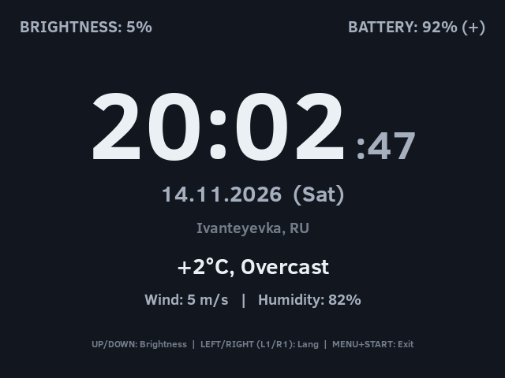

# AlexClock for MustardOS (muOS)

**AlexClock** is a lightweight fullscreen clock, date, and weather application built specifically for handheld gaming consoles running **[MustardOS (muOS)](https://muos.dev/)** (tested on **2606.0 Andromeda**).

Written in pure Python 3 using native `SDL2` and `SDL2_ttf` system libraries via `ctypes` — no external Python packages or compilation required.

---

## Features

- **Large Digital Clock & Date** — Displays hours, minutes, seconds (`HH:MM:SS`), current date, and day of the week.
- **Automatic Location & Weather** — Detects your city by IP and fetches live temperature, sky condition, wind speed (`m/s`), and relative humidity (`%`).
- **Smart Caching & Offline Support** — Saves settings, coordinates, and the latest weather data in `config.json`. Updates every 30 minutes when online (with 3 retry attempts on network failure).
- **Screen Brightness Control** — Adjusts backlight brightness directly from the app (`UP` / `DOWN`) and syncs it with muOS settings.
- **Battery Indicator** — Shows current battery percentage and charging status.
- **Bilingual UI (EN / RU)** — Instant switching between English (default) and Russian interfaces.

---

## Controls

| Button | Action |
| :--- | :--- |
| **D-Pad Up / Down** | Increase / decrease screen brightness (`±10%`) |
| **D-Pad Left / Right** or **L1 / R1** | Switch language (`English` / `Russian`) |
| **MENU + START** | Exit to muOS |

---

## Installation

### Option 1: Using `.muxapp` package (Recommended)
1. Download the latest **`AlexClock.muxapp`** from the [Releases](../../releases) page.
2. Copy `AlexClock.muxapp` to the **`ARCHIVE/`** folder on your SD card.
3. On your console, open **Applications → Archive Manager**, select `AlexClock.muxapp`, and press **A** to install.

### Option 2: Manual Installation
1. Copy the `AlexClock` folder (containing `mux_launch.sh`, `clock.py`, `config.json`, and `glyph/`) to `MUOS/application/AlexClock/` on your SD card.
2. Ensure `mux_launch.sh` and `clock.py` have executable permissions (`chmod +x`) and Unix (`LF`) line endings.

---

## Configuration (`config.json`)

The app stores its state and weather cache in `config.json` inside the application folder:

```json
{
  "lang": "en",
  "city_ru": "Москва, RU",
  "city_en": "Moscow, RU",
  "lat": 55.7558,
  "lon": 37.6173
}
```

You can pre-fill `lat`, `lon`, `city_en`, and `city_ru` manually if you want to lock weather updates to a specific location.
